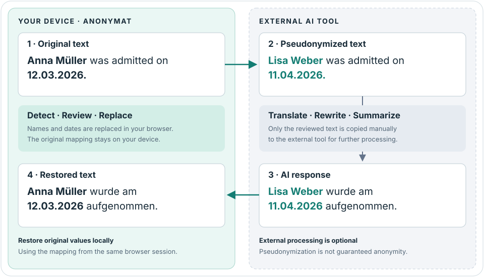

# Anonymat

### Local, reversible text pseudonymization

**Prepare sensitive text for AI-assisted translation, proofreading, summarization and rewriting — without sending the original text to an external service during pseudonymization.**

Anonymat is a local application packaged as a **single, self-contained HTML file**. It runs directly in a modern web browser on virtually any workstation, including Windows, macOS and Linux. No installation, account or server is required. Once downloaded, it also works entirely offline.

**[Open Anonymat in your browser](https://uli-z.github.io/Anonymat/)** · **[Download the offline HTML file](https://github.com/Uli-Z/Anonymat/releases/latest)**

## How it works

Paste a document into Anonymat, review the detected information and inspect the pseudonymized output. Copy the reviewed text to your chosen external tool if needed. Paste the resulting response back into Anonymat to restore original values within the same browser session.

The illustration uses fictional data and shows optional realistic pseudonyms and a consistent date shift.

## Key features

- **Automatic detection:** Names, addresses, locations, contact details, dates, identifiers, amounts and measurements.
- **Full manual control:** Correct detections, review uncertain suggestions, add replacements, ignore individual findings and choose which categories to detect.
- **Placeholders or realistic pseudonyms:** Replace supported names and places with synthetic alternatives, or use identifiable replacement tokens.
- **Consistent date shifting:** Shift dates while preserving chronological relationships where possible.
- **Reversible replacements:** Restore original values in externally edited or translated texts locally.
- **Local and offline:** No server-side text processing or installation; optional browser-local memory for manually confirmed terms. English and German interface.

## Get started

Use the [web app](https://uli-z.github.io/Anonymat/) or download the standalone HTML file from the [latest release](https://github.com/Uli-Z/Anonymat/releases/latest) and open it directly in your browser. The downloaded file requires no internet connection, administrator privileges or additional software beyond a compatible browser.

## Privacy and limitations

> **Pseudonymization is not anonymization.** Automatic detection may miss personal information or produce incorrect matches, and people may remain identifiable from context. Always review the entire output before sharing it with any external service.

Anonymat does not transmit entered text or replacement mappings to a server. Full documents and mappings remain in the browser session. Optional remembered terms are saved in your browser profile with your consent and can be deleted.

Using Anonymat does not automatically make an external processing workflow compliant with data-protection requirements. Restoration can also be incomplete if an external tool changes replacement values.

## Project information

[Source and development guide](v2/README.md) · [Testing](v2/docs/TESTING.md) · [Dictionary sources and licenses](v2/docs/PERFORMANCE_AND_LEXICA.md) · [Release notes](RELEASE_NOTES.md) · [Report an issue](https://github.com/Uli-Z/Anonymat/issues)

Licensed under the [GNU General Public License v3.0](LICENSE).
